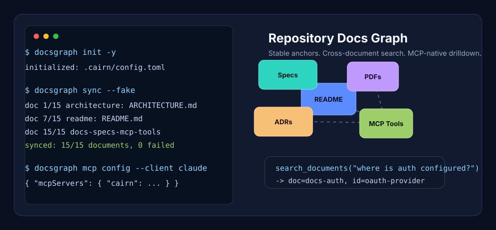

# Cairn

> **The DocsGraph for AI agents. CodeGraph helps agents navigate code; Cairn
> helps them navigate docs. Install it as `docsgraph`; keep the `cairn` name
> for the product and compatibility alias.**

[](https://github.com/jokeuncle/cairn/actions/workflows/ci.yml)
[](LICENSE)
[](https://pypi.org/project/docsgraph/)
[](https://jokeuncle.github.io/cairn/)
[](https://www.python.org/)
[](https://modelcontextprotocol.io/)



Cairn is a **local-first, MCP-native DocsGraph** for software
repositories and large structured documents. It turns README files, specs,
ADRs, docs folders, PDFs, and optional MarkItDown-converted Office/data/web
files into a navigable map: document catalog, hierarchical sections,
multi-granularity summaries, entity mentions, cross-reference edges, and a
semantic vector overlay.

Instead of dumping whole docs into context or relying on anonymous chunks, an
agent can ask Cairn to `list_documents`, `search_documents`, inspect an
`outline`, and drill into exact sections with stable `cairn://` anchors. The
same engine also works for standalone handbooks, papers, and PDFs.

Cairn provides cited, bounded access to documentation through MCP and a local
CLI. It is an experimental infrastructure tool: **a general Agent cost advantage
or commercial superiority has not been established**. See the
[experiment ledger](docs/research/README.md) for retained successes, failures,
controls and scope limits.

The latest public-document studies use real Codex Agents and independent answer
and citation checks. All arms complete the selected tasks; task acceptance is
separate from the predeclared cost gate:

| Study | Completed sessions | Cairn vs fresh raw: input / uncached input / output | Cost gate |
|---|---:|---|---|
| [Explicit document graph](docs/research/2026-10-25-document-links.md) | 6 | −18.5% / −24.1% / +5.1% | Failed |
| [Local reference analysis](docs/research/2026-10-25-reference-impact.md) | 8 | +25.5% / −3.2% / +13.8% | Failed |

These rows use different target-document tasks and are not a before/after causal
comparison. Input is cumulative, uncached input excludes cache hits, and output
includes reasoning. Four target instances share one graph-analysis task family
on two pinned public projects; they do not establish broad generalization.
The analysis study includes a lightweight independent helper with the same
mathematics. Build/storage costs and autonomous skill/verification overhead are
disclosed in the reports. Earlier [retrieval repairs](docs/retrieval-reliability.md),
[Agent cost diagnosis](docs/agent-cost-diagnosis.md), [paper-informed work](docs/research/2026-10-24-evidence-policy.md),
[parity screens](docs/research/2026-10-25-budget-parity.md),
[strong controls](docs/research/2026-10-25-strong-control.md), and the
[CLI screen](docs/research/2026-10-25-lean-cli.md) remain available.
Documentation with local code includes can be
[prepared explicitly](docs/snippet-preparation.md) before indexing.

> 🚀 **Alpha — `0.1.0a13`.** Markdown + PDF ingest, the core MCP tool set,
> the full structure-aware index (tree + summaries + entities + xrefs +
> vectors), repo-level `init/sync/status`, repo-scoped MCP tools with
> `list_documents`, `search_documents`, `repo_context`, `repo_graph`, and
> `repo_impact`, failure-isolated sync, static graph inspector, Doubao
> multimodal embeddings, and an evaluation harness. See
> [`CHANGELOG.md`](CHANGELOG.md) for what's in this
> release and [`ROADMAP.md`](ROADMAP.md) for what's next.

---

## Experimental capabilities (0.1.0a13)

The additions below are included in the **0.1.0a13 alpha** and remain
experimental. Install with `pip install --upgrade docsgraph==0.1.0a13`, or use
`pip install -e .` for this checkout. Defaults
remain hybrid search, synopsis context, the section/entity graph and
artifact/entity impact. Original full text and the new reference views are
explicit choices.

| Need | Tool / option | Model call at query time |
|---|---|---|
| Find matching documents or context | `search_documents`, `repo_context` (hybrid default) | Yes |
| Search literal terms without an endpoint | `retrieval="lexical"` on those tools | No |
| Navigate or read cached sections | `outline`, `get_section` | No |
| Inspect explicit cross-document links | `repo_graph(view="documents")` | No |
| Compute reverse paths, cycles and deletion reachability | `repo_impact(view="references")` | No |

<a href="docs/architecture-current.html">
<picture>
  <source media="(prefers-color-scheme: dark)" srcset="docs/assets/cairn-architecture-dark.svg">
  
</picture>
</a>

[Explore the current architecture](docs/architecture-current.html) ·
[Architecture source and verification](docs/architecture/README.md) ·
[Full architecture contract](ARCHITECTURE.md)

After indexing a repository, the read-only CLI and MCP expose the same handlers:

```sh
docsgraph query tool repo_graph '{"view":"documents"}' --repo /path/to/project

docsgraph query tool repo_impact \
  '{"view":"references","doc":"docs/guide.md","entry":"README.md","max_hops":3}' \
  --repo /path/to/project
```

Replace the example paths with indexed sources (`list_documents` lists them).
The reference view follows explicit Markdown body links and returns canonical
shortest paths, cycle membership, deletion reachability and cited witnesses.
It reports completeness, caps and stale/skipped documents. Heading/code/HTML
links and external/unindexed targets are excluded; fragments are not validated.
References do not establish semantic or source-code impact.

An existing index is still required; query-time availability does not eliminate
embedding, summary-generation, startup or storage costs. The current regression
suite passes **620 tests** ([release validation](docs/research/2026-10-25-release-validation.md)); independent full-source checks cover all **42 target
documents** in the two graph corpora. CLI and MCP stdio graph/impact calls were
verified with the model endpoint stopped. These checks qualify functionality,
not general Agent cost savings. See [CLI usage](docs/cli-retrieval.md),
[embedding role configuration](docs/embedding-instructions.md),
[ADR-0016](docs/decisions/0016-explicit-document-reference-view.md) and
[ADR-0017](docs/decisions/0017-local-reference-impact-analysis.md).

## Retrieval reliability update

Markdown prose before the first heading and documents without headings are
indexed as independent introduction sections. Existing heading anchors keep
their IDs. Run `docsgraph sync` after upgrading: old tree producers rebuild
automatically; a subsequent unchanged sync is a no-op.

`repo_context` returns cited summaries and bounded original evidence once per
section by default. Use `get_section(doc, id, level="full")` for complete examples
and precise conditions. Clients needing the earlier ranking and relationship
payload can pass `include_details=true`. MCP search explanations are also
available with `search_documents(include_details=true)`; the Python library
search response remains detailed. `repo_graph` provides explicit graph inspection.
Section tools accept returned `cairn://doc/section` citations directly and reject
conflicting document namespaces. See [ADR-0004](docs/decisions/0004-lossless-ingest-compact-context.md)
and the [verified repair results](docs/retrieval-reliability.md).

Full section text excludes descendant bodies. Section reads now show bounded,
cited navigation links; `get_related` also finds siblings at the document root.
Compact context selects complementary original evidence rather than repeating
topic overviews. Small fenced code examples stay intact within excerpt budgets;
partial oversized code is marked `truncated_code`.

For a short-context embedding endpoint, explicitly opt into
`CAIRN_EMBED_PROVIDER=windowed-openai-compatible` before indexing and serving.
It embeds all 1,500-byte UTF-8 windows and pools one vector per original section;
it adds embedding work and can dilute localized facts. It does not discard text
or replace the document tree. Run sync after changing providers. Normal rebuilds
reuse stored summaries with matching model/content fingerprints; `sync --force`
bypasses that stored reuse. See [ADR-0007](docs/decisions/0007-explicit-embedding-windows.md)
and [ADR-0008](docs/decisions/0008-reuse-fingerprinted-summaries.md).

## Why Cairn?

| Today | With Cairn |
|---|---|
| AI coding agents guess from README snippets or grep. | Agent gets a repo-level documentation map with stable section anchors. |
| Dump the whole document into context. Burns tokens, dilutes attention. | Agent fetches only what it needs, at the granularity it needs. |
| Naive RAG splits structure into context-free chunks. | The document's own structure is the index. |
| Cross-references and entities are lost in chunking. | They are first-class objects. |
| Locked into one vendor's embeddings / vector DB. | Pluggable everything. Local-first defaults. |
| Different tool stacks for Claude / Cursor / Cline / Goose. | One MCP server. Any compliant agent works. |

For the in-depth motivation, see [`PRODUCT.md`](PRODUCT.md).
For the technical design, see [`ARCHITECTURE.md`](ARCHITECTURE.md).
For the public documentation quality contract Cairn optimizes for, see
[`docs/golden-docs-standard.md`](docs/golden-docs-standard.md).
The product website is published at <https://jokeuncle.github.io/cairn/>.

---

## How It Works (90 seconds)

1. **Discover.** `docsgraph init -y` writes `.cairn/config.toml`; `docsgraph sync`
   discovers README, Markdown docs, ADRs, specs, and PDFs from conservative
   repo globs.
2. **Index.** Each document becomes a normal Cairn index: structural tree (T),
   multi-level summaries (S), entity index (E), cross-reference graph (X), and
   vector overlay (V). A bad source file is isolated instead of breaking the
   whole repo sync. Sync is incremental by default: unchanged source hashes and
   producer fingerprints are skipped unless `--force` is passed. Concurrent
   syncs for the same repo are serialized by `.cairn/sync.lock`, so parallel
   agent sessions wait instead of rebuilding the same documents.
3. **Serve.** `docsgraph serve` exposes repo-scoped MCP tools:
   `list_documents`, `search_documents`, plus `outline`, `get_section`,
   `expand`, `search_semantic`, `search_keyword`, `find_mentions`,
   `get_related`, and `read_range` routed by optional `doc`.
4. **Navigate.** Your agent searches across the repo, picks a document, drills
   into promising sections, and only fetches full text when justified. Every
   result carries stable anchors for verification.

A visual explainer comparing Cairn's approach to RAPTOR, BookRAG, and A-RAG
lives at
[`docs/retrieval-architecture-canvas.html`](docs/retrieval-architecture-canvas.html).
The repository workflow map lives at
[`docs/repo-docs-workflow-canvas.html`](docs/repo-docs-workflow-canvas.html).
Open either file in any browser.

---

## Quickstart

The fastest way to see Cairn work is to index this repo's own documentation.
**Zero API keys, zero model downloads** — the `--fake` flag uses deterministic
in-process plugins so the whole thing runs offline.

The PyPI distribution is `docsgraph`; the primary CLI command is `docsgraph`.
The older `cairn` command is installed as a compatibility alias:

```bash
pip install docsgraph
```

Or run it without installing:

```bash
uvx docsgraph --help
```

AI agents that can run shell commands can install and wire Cairn into their own
MCP config. Start with a dry run, then write the config once the target path
looks right:

```bash
uvx docsgraph init -y
uvx docsgraph sync --fake
uvx docsgraph install --client codex --dry-run --fake
uvx docsgraph install --client codex --yes --fake
```

Use `--client claude`, `--client cursor`, or `--client goose` for other MCP
clients. `docsgraph install` writes the same server config that
`docsgraph mcp config` prints, with `command = "docsgraph"` and
`args = ["serve"]`. The server resolves the current MCP workspace at call time,
so a global agent config does not stay pinned to the repo where it was installed.
Pass `--repo /path/to/repo` to `docsgraph install` or `docsgraph mcp config`
only when you intentionally want a fixed-repo MCP server.

### Repository Workflow

Inside any repository:

```bash
docsgraph init -y
docsgraph discover
docsgraph sync --dry-run
docsgraph sync --fake
docsgraph status
docsgraph query repo "where are docs indexed?" --fake
docsgraph doctor --fake
docsgraph mcp config --client claude --fake
docsgraph serve --fake
docsgraph client --fake
```

`docsgraph discover` and `docsgraph sync --dry-run` explain what will be
indexed before Cairn writes any document indexes: included docs, candidates
that did not match include rules, unsupported extensions, and excluded files
with their matching rule. `docsgraph doctor` checks repo config, index
freshness, primary-doc routing, model settings, and whether the query embedder
matches the indexed embedder mode and dimension. If an index was built with
`--fake` but the MCP server is running a real embedder (or the reverse), doctor
and fixed-repo `serve` print direct recovery commands. `docsgraph mcp config`
prints copy-pasteable stdio snippets for Claude, Cursor, Codex, and Goose. For
hosted providers, pass explicit MCP environment variables with repeated
`--env KEY=VALUE`, or use `--env-from-current` to copy the current `CAIRN_*`
environment into the generated config. `docsgraph client` opens a local browser
UI for init, sync, status, `repo_context` previews, and MCP config install
flows:

```bash
docsgraph mcp config --client claude
docsgraph mcp config --client cursor
docsgraph mcp config --client codex
docsgraph mcp config --client goose
docsgraph mcp config --client codex --repo . --env-from-current
```

For local development from source:

```bash
git clone https://github.com/jokeuncle/cairn.git
cd cairn

python3.11 -m venv .venv
.venv/bin/pip install -e ".[dev]"

# 1. Create .cairn/config.toml with conservative documentation globs.
.venv/bin/docsgraph init -y

# 2. Index README, Markdown docs, and PDFs.
.venv/bin/docsgraph sync --fake

# 3. Inspect freshness and indexed document ids.
.venv/bin/docsgraph status

# 4. Search across all indexed repository docs.
.venv/bin/docsgraph query repo "where are docs indexed?" --fake

# 5. Start the repo-scoped MCP stdio server for Claude Code / Cursor / Cline / Goose.
.venv/bin/docsgraph serve --fake
```

Repo mode writes a shareable config plus ignored runtime data:

```text
.cairn/
  config.toml       # commit this if you want a stable repo docs policy
  manifest.json     # generated
  documents/        # generated per-document Cairn indexes
    readme/
    architecture/
    docs-specs-mcp-tools/
```

Repo-scoped MCP adds:

| Tool | Use it for |
|---|---|
| `list_documents` | See every indexed doc, its source path, freshness, section count, and structured agent usage guidance. |
| `search_documents` | Find ranked, cited source hits across indexed docs. MCP ranking diagnostics are opt-in with `include_details=true`; recovery warnings are preserved. |
| `repo_context` | Get cited summaries and bounded original evidence once per section. Request `include_details=true` for ranking diagnostics and expanded relationships. |
| `repo_graph` | Inspect the repo documentation graph: document, section, entity, contains, xref, and mention edges. Cross-document links are exposed through shared entity nodes. |
| `repo_impact` | Estimate documentation surfaces affected by a document or section change. |
| `search_keyword` | Search all indexed docs when `doc` is omitted, or one selected doc when `doc` is provided. |
| normal Cairn tools + `doc` | Drill into a chosen document with `outline`, `get_section`, `search_semantic`, `get_related`, etc. |

Cairn is intentionally a docs graph, not a universal first step. Prefer
`repo_context` / `search_documents` for documentation, product, architecture,
setup, naming, protocols, business workflows, and durable decision records.
Prefer CodeGraph or native project tools for source-code symbol tracing, small
known-file edits, test output, build logs, and exact literal search.
`list_documents` returns the same usage boundary as structured
`usage_guidance` so MCP clients can route tasks without parsing README prose.

Repo behavior is intentionally configurable in `.cairn/config.toml`:

| Setting | Default | Impact |
|---|---|---|
| `include` | README, top-level Markdown/PDF, `docs/**`, `guides/**`, `specs/**`, ADR/decision/design/product/requirements/RFC/proposal dirs, one-level nested README | Expands or narrows what Cairn treats as repository documentation. Broader globs improve coverage but can index noisy generated files. |
| `exclude` | `.git`, `.cairn`, `.codegraph`, caches, virtualenvs, package stores, build/site/coverage output, `node_modules` | Keeps generated or tool-owned docs out of search. Simple `name/**` directory excludes match at any depth, so `frontend/node_modules/...` and `apps/web/dist/...` are skipped. Add project-specific generated doc folders here. |
| `enable_markitdown` | `false` | Enables non-Markdown/PDF conversion when the `markitdown` extra is installed. Useful for DOCX/PPTX/XLSX/HTML-heavy repos, slower and less deterministic than native Markdown/PDF parsing. |
| `primary_doc` | `readme` | Chooses the default document for normal tools when `doc` is omitted in repo mode. |
| `search_sections_per_doc` | `1` | Default diversity for `search_documents`. `1` helps agents find the right doc first; raise it when a repo has a few long docs and you want deeper hits from each doc by default. |
| `preferred_locales` | `[]` | Optional locale preference for repo search, for example `["en"]` or `["zh"]`. When omitted, English queries prefer English or locale-neutral docs without hiding other languages. |

Markdown frontmatter is treated as generic document metadata. Cairn indexes
common fields such as `title`, `description`, `tags`, `date`, and `draft`, uses
them in keyword and semantic evidence, and marks metadata matches in search
explanations. Empty parent headings remain useful navigation nodes, but they
are down-ranked as primary evidence when a non-empty child section better
answers the query.

MarkItDown integration is local-file only and optional. Cairn uses it as a
conversion layer, then feeds the generated Markdown into the same canonical
Markdown parser. This expands coverage to formats such as DOCX, PPTX, XLSX,
HTML, CSV, JSON, XML, and EPUB without making the base install heavy:

```bash
pip install "docsgraph[markitdown]"
.venv/bin/docsgraph init -y --force --markitdown
.venv/bin/docsgraph sync --fake
```

Generate a standalone graph inspector for the primary repo doc:

```bash
docsgraph inspect --out /tmp/cairn-repo-inspector.html
```

### Single Document Workflow

Cairn still works as a focused index for one large document:

```bash
# Index Cairn's own architecture document.
.venv/bin/docsgraph index ARCHITECTURE.md --out /tmp/cairn-arch --fake

# Get the map — gists only, never full text.
.venv/bin/docsgraph outline /tmp/cairn-arch --depth 2

# Keyword search: every section that mentions "LanceDB".
.venv/bin/docsgraph query keyword /tmp/cairn-arch LanceDB

# Multi-term keyword search with mode=all.
.venv/bin/docsgraph query keyword /tmp/cairn-arch progressive disclosure --mode all

# Generate a standalone graph inspector for the built index.
.venv/bin/docsgraph inspect /tmp/cairn-arch --out /tmp/cairn-arch/inspector.html

# Start a single-document MCP stdio server.
.venv/bin/docsgraph serve /tmp/cairn-arch --fake
```

A walkthrough with full output and an MCP-client config snippet is in
[`examples/hero-demo.md`](examples/hero-demo.md).

### Benchmarks

Cairn ships with `cairn-bench`, a small framework that compares Cairn against
a naive 512-word-chunk vector-RAG baseline (both backed by LanceDB and the
same embedder, so the comparison is apples-to-apples).

Running the starter suite (10 hand-curated questions over Cairn's own
`ARCHITECTURE.md`) with deterministic in-process plugins:

```bash
docsgraph bench benchmarks/architecture.toml --fake
```

| metric | naive vector RAG | Cairn |
|---|---:|---:|
| mean recall@8 | 45% | 25% |
| mean tokens returned | 4,374 | 1,362 (31.1% of naive) |

These0.1.0a13 numbers use the deterministic `FakeEmbedder` (a bag-of-words
hash with no semantic understanding). Cairn has lower recall on this small,
legacy fixture. Smaller returned payloads do not establish task success or
whole-Agent savings. The questions and anchors are unchanged; the architecture
document evolved. This is a development demonstration, not a semantic benchmark
or evidence that this release outperforms the baseline.
[Raw result](benchmarks/repo-quality/release-starter-results-20261025.json) and
[release limitations](docs/research/2026-10-25-release-validation.md) are public.
Run with a configured real provider for a semantic comparison; see
[`benchmarks/README.md`](benchmarks/README.md) for suite authoring.

Repo-level smoke tests are also public and reproducible:

```bash
python scripts/eval_repos.py --repo all --refresh --strict
python scripts/smoke_many_repos.py --limit 37 --strict
```

The labeled eval set covers `astral-sh/uv`, `pydantic/pydantic-ai`,
`modelcontextprotocol/python-sdk`, and `fastapi/full-stack-fastapi-template`.
The broad smoke matrix currently spans 37 public repositories across Python,
JavaScript/TypeScript, Rust, and Go ecosystems. It is not an accuracy
leaderboard; it verifies clone/discovery/sync/search/drilldown robustness and
latency across different documentation shapes.

Latest fake-plugin runs on this machine:

| suite | result |
|---|---|
| `pydantic-ai` labeled eval | 178/178 docs indexed, 8/8 top1, 8/8 top5, 8/8 drilldown |
| `uv` labeled eval | 89/89 docs indexed, 15/16 top1, 16/16 top3/top5, 16/16 drilldown |
| `mcp-python-sdk` labeled eval | 17/17 docs indexed, 4/4 top1, 4/4 drilldown |
| `fastapi-template` labeled eval | 7/7 docs indexed, 4/4 top1, 4/4 drilldown |
| 37-repo smoke matrix | 2931 docs indexed, 0 sync failures, 185/185 searches with hits, 185/185 drilldowns |

`search_documents` uses a general hybrid ranker: dense vector similarity,
BM25-style sparse evidence, structure-aware field support, weighted query-term
coverage, path/title identity prior, and local graph-neighborhood propagation.
Repo search builds a process-local cache and scores dense vectors in batches so
large documentation sets stay warm-query friendly. On large section sets it
uses a two-stage path: dense seeds, cheap lexical/path seeds, and graph
neighbors form a wide shortlist, then the full BM25/graph/explanation ranker
scores only that candidate set. Cold cache construction loads per-document
indexes concurrently while preserving per-document failure isolation.
Library responses and MCP diagnostic views expose `ranker.mode`, `total_sections`,
and `scored_sections`, plus score breakdowns and explanations. MCP source views
keep citations and requested evidence compact by default; use
`include_details=true` when inspecting ranking behavior.
Changelog, release-note, and migration-history documents are intent-gated: they
stay first-class results for release/version/change queries, but broad topic
queries prefer guides, API docs, and README-style docs when comparable evidence
exists.
Search candidates are freshness-aware: repo status records a file-level
fingerprint, and query responses expose `stale_documents` when source files have
changed since the last sync.
`repo_context` composes search, section content, and local relationships into
one agent-ready payload; `repo_graph` and `repo_impact` expose the documentation
graph without reimplementing source-code analysis. Pair Cairn with CodeGraph
when you need AST symbols, callers/callees, or code impact.
The ranker does not special-case repository names, document ids, or benchmark
answers.

### Real LLM + real embeddings

The `--fake` plugins are great for offline reproducibility but they have no
semantic understanding. For production indexing, point Cairn at any
OpenAI-compatible endpoint. The defaults target a **local Ollama** so you
keep the local-first promise without paying for API tokens:

```bash
ollama serve
ollama pull llama3.2:3b
ollama pull nomic-embed-text

.venv/bin/docsgraph index ARCHITECTURE.md --out /tmp/cairn-arch   # no --fake
```

OpenAI, vLLM, Together, Anyscale, …all of them work the same way; override
`CAIRN_LLM_*` and `CAIRN_EMBED_*` environment variables.

For Doubao's vision embedding model, use the dedicated provider because the
model is served through Volcengine's `/embeddings/multimodal` endpoint:

```bash
export CAIRN_LLM_BASE_URL=https://ark.cn-beijing.volces.com/api/v3
export CAIRN_LLM_MODEL=doubao-seed-2-0-code-preview-260215
export CAIRN_LLM_API_KEY=...

export CAIRN_EMBED_PROVIDER=doubao-vision
export CAIRN_EMBED_MODEL=doubao-embedding-vision-251215
export CAIRN_EMBED_API_KEY=...

docsgraph index ARCHITECTURE.md --out /tmp/cairn-arch
```

When installing an MCP server for an agent, make the query-side provider
explicit too. Agent clients do not reliably inherit your interactive shell
state, and Cairn does not implicitly load private dotenv files:

```bash
docsgraph install --client codex --repo . --env-from-current --yes
docsgraph doctor
```

If `doctor` reports `query_embedding_dim` mismatch, rebuild or restart the MCP
server with the same `CAIRN_EMBED_*` provider and dimension used for indexing.

To run the public-repo eval with the real provider configured by your
environment instead of the deterministic fake plugins:

```bash
python scripts/eval_repos.py --repo pydantic-ai \
  --provider env \
  --workdir /tmp/cairn-repo-eval-real \
  --refresh
```

The eval report includes provider mode, model names, and vector dimension, but
never prints API keys. Cairn also invalidates old indexes when the summarizer,
embedder, vector dimension, entity extractor, or xref extractor changes, so
switching from `--fake` to Doubao rebuilds the affected documents instead of
quietly reusing incompatible vectors.

Useful operational knobs when running against hosted APIs:

| variable | default | purpose |
|---|---:|---|
| `CAIRN_LLM_TIMEOUT` | `60` | per-request summary timeout in seconds |
| `CAIRN_LLM_MAX_RETRIES` | `2` | retries for 429/5xx and transport errors |
| `CAIRN_EMBED_TIMEOUT` | `60` | per-request embedding timeout in seconds |
| `CAIRN_EMBED_MAX_RETRIES` | `2` | retries for embedding 429/5xx and transport errors |
| `CAIRN_SUMMARY_CONCURRENCY` | `4` | concurrent summary calls during indexing and benchmarks |
| `CAIRN_SUMMARY_BATCH_SIZE` | `1` | optional prompt-packed section summaries per chat request for batch-capable summarizers |
| `CAIRN_EMBED_BATCH_SIZE` | `32` | sections/chunks per embedding batch |
| `CAIRN_EMBED_CONCURRENCY` | `8` | concurrent per-item Doubao vision embedding requests within a batch |

---

## Inspiration and Lineage

Cairn synthesizes two strands of recent research and ships them as a real,
agent-ready tool:

- **[BookRAG](https://arxiv.org/abs/2512.03413)** (Dec 2025): structure-aware
  index combining a hierarchical tree with an entity graph, queried via an
  Information-Foraging-Theory-inspired agent. Cairn implements this vision in
  production-grade form.
- **[A-RAG](https://arxiv.org/abs/2602.03442)** (Feb 2026): clean agent loop
  with hierarchical retrieval tools (keyword/semantic/chunk). Cairn borrows the
  agent-tool philosophy and replaces A-RAG's chunk-based index with a
  structure-first one.
- **[RAPTOR](https://arxiv.org/abs/2401.18059)** (ICLR 2024): the seminal
  recursive-summarization tree. Cairn's summary layer takes inspiration from it
  while anchoring summaries to the document's own structure instead of
  clustered chunks.

We are deeply grateful to these authors; see ADRs for the specific design
choices we adopted, modified, or declined.

---

## Status & Roadmap

| Phase | Status | What |
|---|---|---|
| 0 — Foundation | ☑ | Authoritative docs in place (PRODUCT, ARCHITECTURE, CLAUDE, ROADMAP, ADR-0001) |
| 1 — v0.1 walking skeleton | ☑ | Markdown ingest, Tree + Summaries + Vectors indexes, 5 MCP tools, stdio server, CLI, hero demo |
| 2 — v0.2 structure-aware retrieval | ☑ | Entities, cross-references, PDF ingest, digest summaries, incremental rebuild, static inspector, `cairn-bench` |
| 3 — v0.3 repo docs graph | ◐ | Repo `init/sync/status`, repo-scoped MCP, `list_documents`, `search_documents`, `repo_context`, `repo_graph`, `repo_impact`, shareable `.cairn/config.toml`; hosted inspector and telemetry still next |
| 4 — v0.4 polish for production | ☐ | DOCX/RTF/EPUB, VSCode extension, security review |
| v1.0 GA | ☐ | All `PRODUCT.md` §7 success criteria met |

Full plan: [`ROADMAP.md`](ROADMAP.md). CI runs ruff, strict mypy, pytest, and
package build checks across Python 3.11, 3.12, and 3.13.

Maintainer release gate: [`docs/release-checklist.md`](docs/release-checklist.md).

Support and sponsorship options live in [`SUPPORT.md`](SUPPORT.md).

---

## Contributing

Cairn is opinionated. Before opening a PR, please read:

1. [`PRODUCT.md`](PRODUCT.md) — especially the non-goals.
2. [`ARCHITECTURE.md`](ARCHITECTURE.md) — the end-state design we're building toward.
3. [`CONTRIBUTING.md`](CONTRIBUTING.md) — workflow and PR expectations.
4. [`docs/decisions/`](docs/decisions/) — existing ADRs.

If you're an AI agent helping a contributor, you'll find your session anchor in
[`CLAUDE.md`](CLAUDE.md).

---

## License

Apache 2.0. See [`LICENSE`](LICENSE).

---

*A cairn is a small stack of stones marking a trail through difficult terrain.
This project is one for AI agents lost in large documents.*
